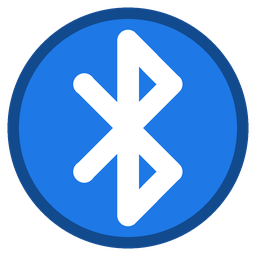

# BT Quick Connect

Значок в трее Windows, который подключает Bluetooth-наушники двойным щелчком — без похода в «Параметры».

| Огонёк | Что значит |
|---|---|
| 🔴 красный | устройство не выбрано, больше не спарено или Bluetooth выключен |
| 🟠 оранжевый | устройство выбрано и спарено, но не подключено |
| 🟢 зелёный | подключено |

## Как пользоваться

1. Скачайте `BtQuickConnect.exe` из [последнего релиза](https://github.com/Mike-iLeech/BtQuickConnect/releases/latest) и запустите.
2. Правой кнопкой по огоньку → **Выбрать устройство**.
3. Двойной щелчок по огоньку — подключить. Пока идёт подключение, огонёк мигает.

В том же меню: **Отключить**, **Кнопка подключения** (комбинация клавиш, F13–F24, мультимедийные клавиши,
средняя или боковые кнопки мыши), **Запускать вместе с Windows**, **Обновлять автоматически**.

Нужен [.NET 8 Desktop Runtime](https://dotnet.microsoft.com/download/dotnet/8.0) — если его нет, Windows предложит скачать при первом запуске.

## Как это работает

Подключение идёт тем же путём, что и кнопка «Подключить» в параметрах Bluetooth Windows: приложение находит
аудиодрайвер устройства (KS-фильтры с тем же ContainerId, что у `BTHENUM\DEV_<адрес>`) и посылает ему
`KSPROPERTY_ONESHOT_RECONNECT`. Поэтому подключаются устройства со звуком — наушники, гарнитуры, колонки.
Геймпады, мыши и клавиатуры Windows со стороны ПК не подключает: их достаточно включить.

Устройства только с Bluetooth LE в списке не показываются.

Настройки лежат в `%APPDATA%\BtQuickConnect\settings.json`.

## Обновления

Через 30 секунд после запуска и дальше раз в 6 часов программа спрашивает GitHub о последнем релизе.
Новую версию она скачивает рядом с собой, сверяет размер и SHA-256 с данными GitHub, переименовывает себя в
`BtQuickConnect.exe.old`, ставит новую на место и перезапускается. Если новая версия не стартует — старая
возвращается на место. Если автообновление выключено, обновление ставится из меню.

Папка с программой должна быть доступна на запись (не `Program Files`).

## Сборка

```
dotnet test tests/BtQuickConnect.Tests.csproj
dotnet publish BtQuickConnect.csproj -c Release -o publish
```

Иконка EXE генерируется `python tools/make_icon.py` (нужен Pillow).

Выпуск: поднять `<Version>` в `BtQuickConnect.csproj`, дописать `CHANGELOG.md`, поставить тег `vX.Y.Z` —
GitHub Actions соберёт EXE и опубликует релиз.
